# AI-Based Agricultural Commodity Price Prediction and Optimal Market Recommendation Using Machine Learning, AIS and PSO

## Project Overview

This project presents an intelligent agricultural commodity price estimation and market recommendation system using Machine Learning (ML), Artificial Immune System (AIS), and Particle Swarm Optimization (PSO).

The system analyzes agricultural commodity prices across different Indian states, districts, and agricultural markets. It estimates commodity prices using machine learning models and applies optimization techniques to improve prediction performance.

The project also provides market recommendations based on reported commodity prices, helping users identify markets with potentially favorable selling opportunities.

Three major approaches are investigated:

1. **Baseline Machine Learning Models**
2. **Artificial Immune System (AIS)-Optimized Random Forest**
3. **Particle Swarm Optimization (PSO)-Optimized Random Forest**

The performance of these approaches is evaluated using regression metrics and graphical visualizations.

---

## Project Objectives

The primary objectives of this project are:

- Analyze agricultural commodity prices across Indian markets.
- Develop machine learning models for commodity price estimation.
- Identify relationships among agricultural price variables.
- Apply Artificial Immune System optimization to Random Forest.
- Apply Particle Swarm Optimization to Random Forest.
- Compare baseline, AIS, and PSO model performance.
- Identify agricultural markets offering relatively higher reported prices.
- Generate prediction results and evaluation reports.
- Develop a reusable machine learning framework for agricultural price analysis.

---

## Project Visualization

The following graph compares the predictive performance of the baseline machine learning models.

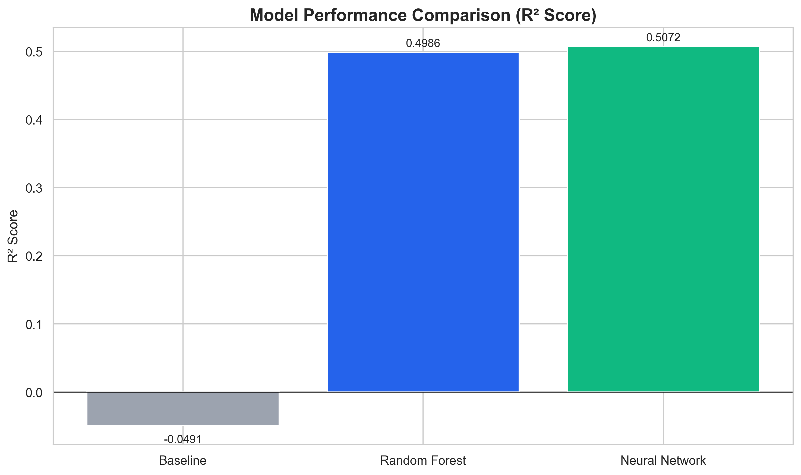

**Figure 1: Baseline Machine Learning Model Performance Comparison**

The graph presents R² scores for the evaluated models.

R² measures how effectively the model explains variation in commodity prices.

Higher R² values indicate better predictive performance, while negative R² values indicate performance worse than predicting the test-set mean.

The actual performance values depend on the dataset and trained models.

---

## Dataset Description

### Dataset Information

**Dataset File:**

`9ef84268-d588-465a-a308-a864a43d0070.csv`

**Dataset Source:** Agricultural commodity market price records.

The supplied dataset contains approximately:

| Attribute | Value |
|---|---|
| Total Records | 17,142 |
| Total Columns | 10 |
| States | 27 |
| Markets | 1,840 |
| Commodities | 266 |
| Data Type | Structured CSV |
| Prediction Target | Modal Price |
| Application Domain | Agriculture and Machine Learning |

### Dataset Features

| Feature | Description |
|---|---|
| State | Indian state |
| District | District associated with the market |
| Market | Agricultural market name |
| Commodity | Agricultural commodity |
| Variety | Commodity variety |
| Grade | Commodity quality classification |
| Arrival_Date | Date of market price reporting |
| Min_x0020_Price | Minimum reported commodity price |
| Max_x0020_Price | Maximum reported commodity price |
| Modal_x0020_Price | Representative modal commodity price |

### Target Variable

The target variable is:

`Modal_Price`

The system estimates the modal price of agricultural commodities based on their categorical market attributes.

### Dataset Limitation

The supplied dataset contains observations from a single reporting date.

Therefore, the current project evaluates cross-market commodity price estimation rather than genuine future-date price forecasting.

Future forecasting requires historical records covering multiple dates.

---

## Technologies Used

### Programming Language

- Python 3.10+
- Jupyter Notebook

### Data Processing

- NumPy
- Pandas

### Machine Learning

- Scikit-learn
- Random Forest Regressor
- TensorFlow
- Keras
- Neural Networks

### Optimization Algorithms

- Artificial Immune System (AIS)
- Clonal Selection Algorithm (CLONALG)
- Particle Swarm Optimization (PSO)

### Data Visualization

- Matplotlib
- Seaborn

### Model Storage

- Joblib
- HDF5
- YAML
- JSON

---

## System Architecture

The proposed system follows the architecture:

```text
Agricultural Commodity Dataset
              |
              v
       Data Preprocessing
              |
              v
       Feature Engineering
              |
              v
       Train/Test Splitting
              |
              v
    Machine Learning Models
              |
      +-------+-------+
      |               |
      v               v
 Random Forest    Neural Network
      |
      v
 Optimization Algorithms
      |
  +---+---+
  |       |
  v       v
 AIS     PSO
  |       |
  +---+---+
      |
      v
 Model Evaluation
      |
      v
 Performance Comparison
      |
      v
 Price Estimation Results
      |
      v
 Market Recommendation System
      |
      v
 Reports and Visualizations
```

AIS and PSO are implemented as separate optimization approaches for Random Forest hyperparameters.

The market recommendation module independently ranks markets using reported commodity prices.

---

## Data Preprocessing

The preprocessing stage prepares the dataset for machine learning.

### 1. Data Cleaning

The following operations are performed:

- Remove duplicate records.
- Handle missing categorical values.
- Convert price columns into numeric format.
- Remove invalid target values.
- Convert reporting dates into datetime format.
- Standardize column names.

### 2. Categorical Encoding

The following categorical variables are encoded:

- State
- District
- Market
- Commodity
- Variety
- Grade

One-Hot Encoding converts categorical attributes into numerical representations suitable for machine learning.

### 3. Feature Selection

The prediction models use categorical market information as input features.

Minimum and maximum reported prices are excluded from model inputs to reduce target leakage.

### 4. Dataset Splitting

The dataset is divided into:

- 80% development data
- 20% testing data

The development data is further divided for model training and validation.

A fixed random seed of 42 is used to support reproducibility.

---

# Machine Learning Models

## 1. Random Forest Regressor

Random Forest is an ensemble learning algorithm that combines predictions from multiple decision trees.

Each decision tree learns relationships between agricultural market attributes and commodity prices.

The final predicted value is obtained by averaging predictions from individual trees.

### Advantages

- Handles nonlinear relationships.
- Supports high-dimensional encoded features.
- Reduces variance compared with individual decision trees.
- Performs well on many structured datasets.
- Provides a strong baseline for optimization experiments.

### Baseline Configuration

```python
RandomForestRegressor(
    n_estimators=150,
    max_depth=20,
    min_samples_leaf=2,
    random_state=42,
    n_jobs=-1
)
```

---

## 2. Artificial Neural Network

A feedforward neural network is implemented using TensorFlow and Keras.

### Network Architecture

```text
Input Layer
    |
    v
Dense Layer (256 neurons, ReLU)
    |
    v
Dropout (0.20)
    |
    v
Dense Layer (128 neurons, ReLU)
    |
    v
Dropout (0.15)
    |
    v
Dense Layer (64 neurons, ReLU)
    |
    v
Output Layer (1 neuron)
```

### Training Configuration

| Parameter | Value |
|---|---|
| Optimizer | Adam |
| Learning Rate | 0.001 |
| Loss Function | Mean Squared Error |
| Maximum Epochs | 100 |
| Batch Size | 64 |
| Early Stopping | Enabled |

The neural network predicts continuous commodity price values.

---

# Artificial Immune System (AIS)

## Overview

Artificial Immune System is a bio-inspired optimization technique based on the adaptive behavior of biological immune systems.

This project implements the Clonal Selection Algorithm (CLONALG) to optimize Random Forest hyperparameters.

The algorithm uses candidate solutions called antibodies.

Each antibody represents a possible Random Forest configuration.

## AIS Optimization Process

1. Initialize a population of antibodies.
2. Evaluate antibody fitness using cross-validation RMSE.
3. Select high-affinity antibodies.
4. Clone selected antibodies.
5. Apply mutation to cloned antibodies.
6. Evaluate the mutated candidates.
7. Retain high-performing antibodies.
8. Introduce new random antibodies.
9. Repeat until the configured generations are completed.

## AIS Parameters

| Parameter | Value |
|---|---|
| Population Size | 8 |
| Generations | 8 |
| Selected Antibodies | 3 |
| Clones per Antibody | 3 |
| New Random Antibodies | 2 |
| Cross-Validation Folds | 3 |
| Optimization Objective | Minimize RMSE |

## Optimized Hyperparameters

AIS optimizes:

- `n_estimators`
- `max_depth`
- `min_samples_split`
- `min_samples_leaf`
- `max_features`

## AIS Fitness Function

The optimization objective is to minimize cross-validation Root Mean Squared Error.

\[
Fitness = RMSE
\]

\[
RMSE =
\sqrt{
\frac{1}{n}
\sum_{i=1}^{n}
(y_i-\hat{y}_i)^2
}
\]

Lower fitness values indicate better candidate solutions.

## AIS Outputs

- `Ais_model.pkl`
- `Ais_model.h5`
- `Ais_config.yaml`
- `Ais_metrics.json`
- `Ais_accuracy_graph.png`
- `Ais_heatmap.png`
- `Ais_comparison_graph.png`
- `Ais_result.csv`
- `Ais_result_graph.png`
- `Ais_prediction.csv`
- `Ais_prediction_graph.png`
- `Ais_convergence_graph.png`
- `Ais_optimization_history.csv`
- `Ais_market_recommendations.csv`
- `Ais_project_summary.json`

---

# Particle Swarm Optimization (PSO)

## Overview

Particle Swarm Optimization is a population-based optimization algorithm inspired by the collective behavior of birds and fish.

PSO searches for improved Random Forest hyperparameters using particles moving through a multidimensional search space.

Each particle represents a candidate model configuration.

## PSO Optimization Process

1. Initialize particle positions and velocities.
2. Evaluate particle fitness using cross-validation RMSE.
3. Update each particle's personal best position.
4. Identify the global best position.
5. Update particle velocities.
6. Update particle positions.
7. Apply search-space boundaries.
8. Repeat the process until the maximum iterations are completed.

## PSO Velocity Equation

\[
v_i^{t+1} =
wv_i^t
+
c_1r_1(pbest_i-x_i^t)
+
c_2r_2(gbest-x_i^t)
\]

Where:

- \(v_i\) = Particle velocity
- \(w\) = Inertia weight
- \(c_1\) = Cognitive coefficient
- \(c_2\) = Social coefficient
- \(r_1,r_2\) = Random values
- \(pbest\) = Personal best position
- \(gbest\) = Global best position

## PSO Position Equation

\[
x_i^{t+1}=x_i^t+v_i^{t+1}
\]

## PSO Configuration

| Parameter | Value |
|---|---|
| Number of Particles | 8 |
| Maximum Iterations | 8 |
| Inertia Weight | 0.7 |
| Cognitive Coefficient | 1.5 |
| Social Coefficient | 1.5 |
| Cross-Validation Folds | 3 |
| Optimization Objective | Minimize RMSE |

## PSO Outputs

- `pso_model.pkl`
- `pso_model.h5`
- `pso_config.yaml`
- `pso_metrics.json`
- `pso_accuracy_graph.png`
- `pso_heatmap.png`
- `pso_comparison_graph.png`
- `pso_result.csv`
- `pso_result_graph.png`
- `pso_prediction.csv`
- `pso_prediction_graph.png`
- `pso_convergence_graph.png`
- `pso_optimization_history.csv`
- `pso_market_recommendations.csv`
- `pso_project_summary.json`

---

# Model Evaluation

The models are evaluated using four regression metrics.

## 1. Mean Absolute Error (MAE)

\[
MAE =
\frac{1}{n}
\sum_{i=1}^{n}
|y_i-\hat{y}_i|
\]

MAE measures the average absolute difference between actual and predicted commodity prices.

Lower MAE indicates better prediction performance.

## 2. Root Mean Squared Error (RMSE)

\[
RMSE =
\sqrt{
\frac{1}{n}
\sum_{i=1}^{n}
(y_i-\hat{y}_i)^2
}
\]

RMSE penalizes larger prediction errors more heavily.

Lower RMSE indicates better performance.

## 3. Coefficient of Determination (R²)

\[
R^2 =
1-
\frac{
\sum(y_i-\hat{y}_i)^2
}{
\sum(y_i-\bar{y})^2
}
\]

R² measures the proportion of target variance explained by the model.

Higher values indicate better performance.

## 4. Mean Absolute Percentage Error (MAPE)

\[
MAPE =
\frac{100}{n}
\sum_{i=1}^{n}
\left|
\frac{y_i-\hat{y}_i}{y_i}
\right|
\]

MAPE measures prediction error as a percentage of actual prices.

Lower MAPE indicates better performance.

---

# Results and Visualizations

## 1. Baseline Accuracy Graph


**Figure 1: Baseline Model Performance**

Compares the R² scores of baseline regression models.

---

## 2. Correlation Heatmap


**Figure 2: Agricultural Price Correlation Heatmap**

Shows relationships among minimum price, maximum price, modal price, and price spread.

The heatmap is used for descriptive analysis rather than as evidence of causal relationships.

---

## 3. Baseline Model Comparison

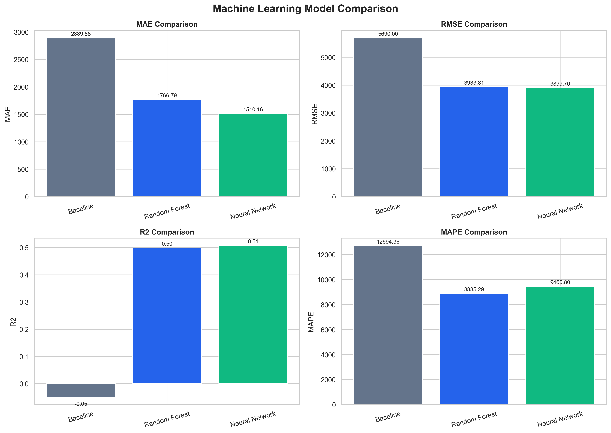

**Figure 3: Baseline Machine Learning Comparison**

Compares MAE, RMSE, R² and MAPE.

---

## 4. Actual vs Predicted Results

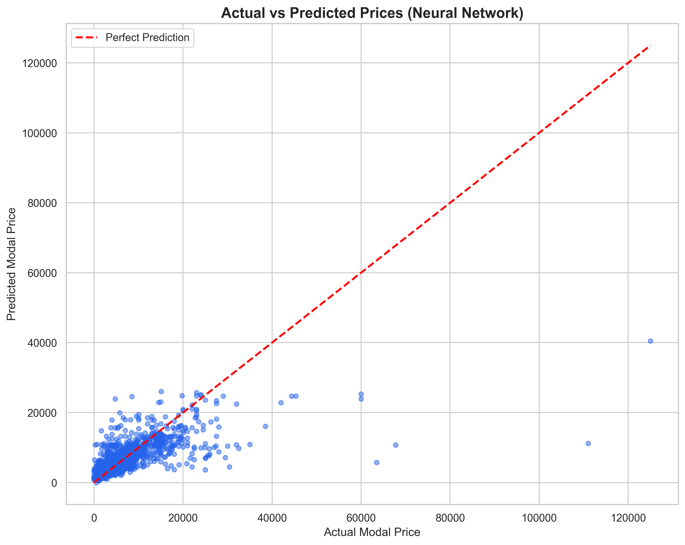

**Figure 4: Actual and Predicted Commodity Prices**

Shows how closely model predictions match observed modal prices.

Points closer to the diagonal reference line indicate smaller prediction errors.

---

## 5. Commodity Price Prediction Graph

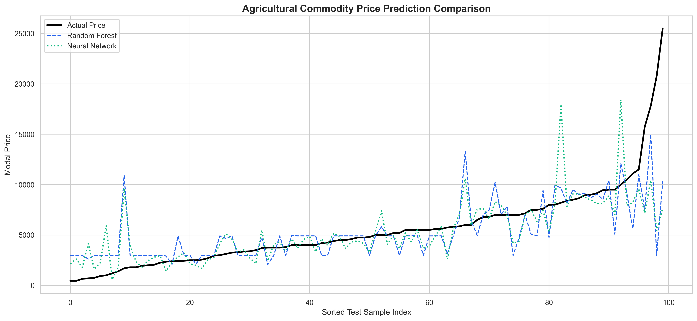

**Figure 5: Commodity Price Prediction Comparison**

Displays actual commodity prices and model predictions for selected test records.

---

## 6. AIS Accuracy Graph

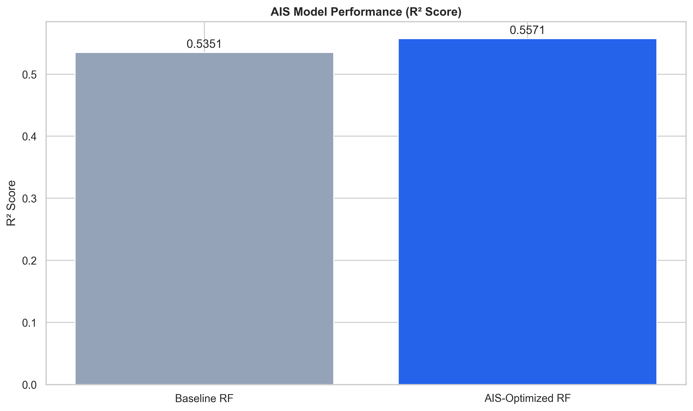

**Figure 6: AIS-Optimized Model Performance**

Compares the baseline Random Forest and AIS-optimized Random Forest using R² scores.

---

## 7. AIS Correlation Heatmap

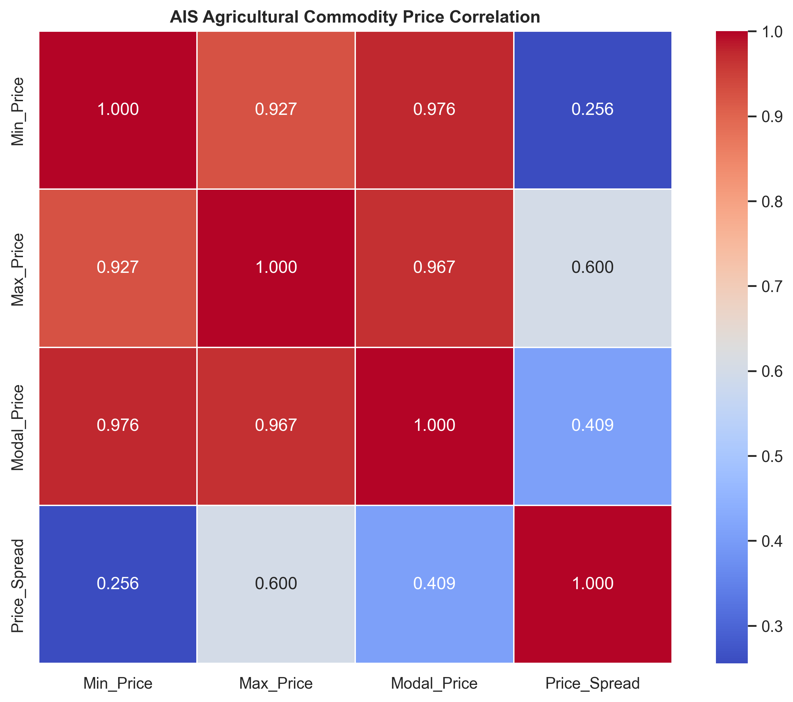

**Figure 7: AIS Experiment Price Correlation Heatmap**

Displays correlations among reported agricultural price variables.

---

## 8. AIS Model Comparison

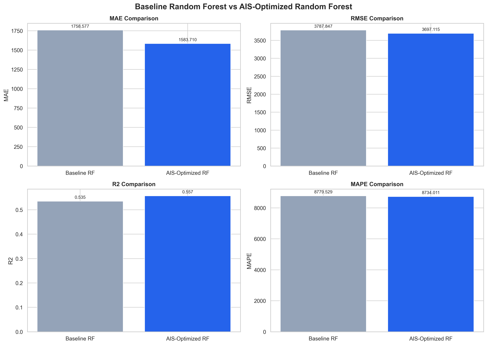

**Figure 8: Baseline vs AIS Performance Comparison**

Compares MAE, RMSE, R² and MAPE.

---

## 9. AIS Actual vs Predicted Results


**Figure 9: AIS Actual vs Predicted Prices**

Shows the relationship between actual and AIS-estimated commodity prices.

---

## 10. AIS Prediction Graph

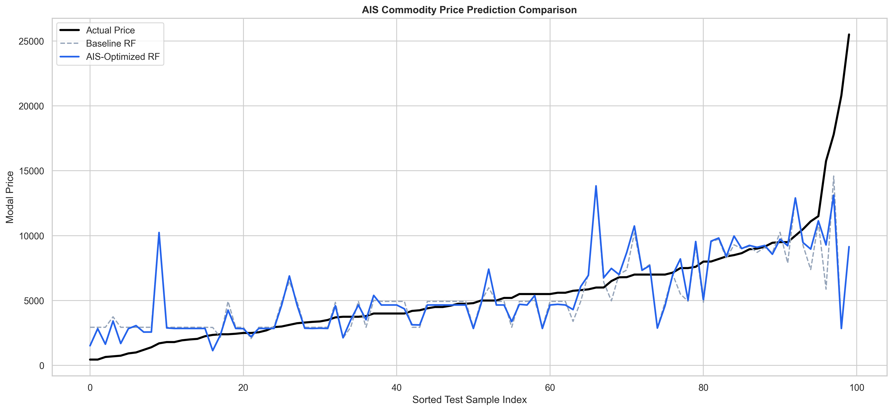

**Figure 10: AIS Commodity Price Prediction**

Compares actual prices, baseline predictions, and AIS predictions.

---

## 11. AIS Convergence Graph

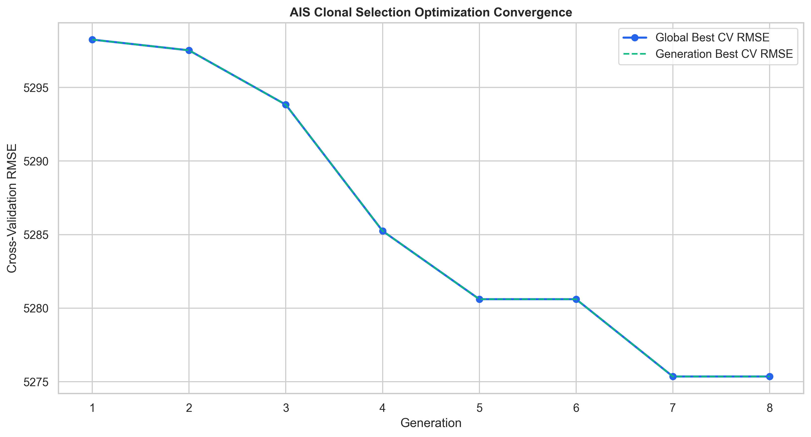

**Figure 11: AIS Optimization Convergence**

Shows the best cross-validation RMSE obtained across AIS generations.

---

## 12. PSO Accuracy Graph

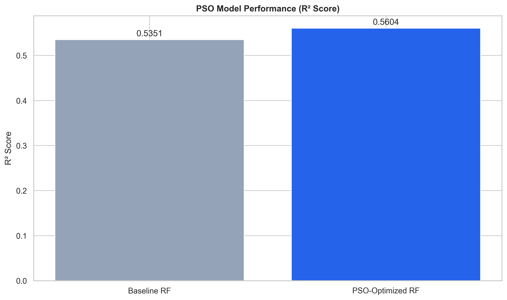

**Figure 12: PSO-Optimized Model Performance**

Compares baseline Random Forest and PSO-optimized Random Forest using R² scores.

---

## 13. PSO Correlation Heatmap


**Figure 13: PSO Experiment Price Correlation Heatmap**

Displays the correlation structure of agricultural price variables.

---

## 14. PSO Model Comparison

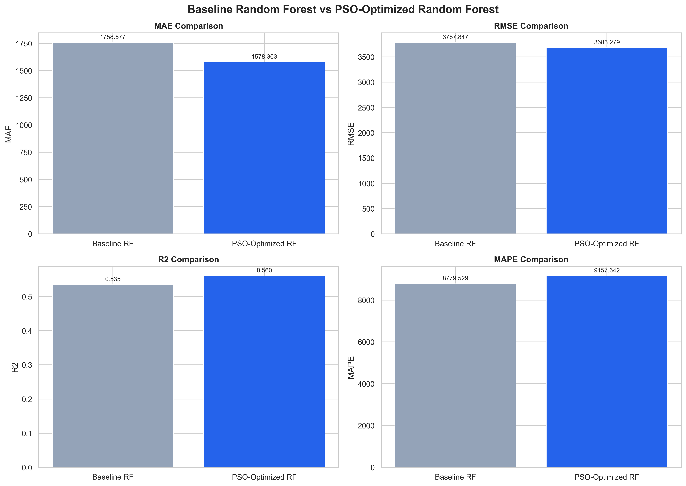

**Figure 14: Baseline vs PSO Performance Comparison**

Compares MAE, RMSE, R² and MAPE.

---

## 15. PSO Actual vs Predicted Results

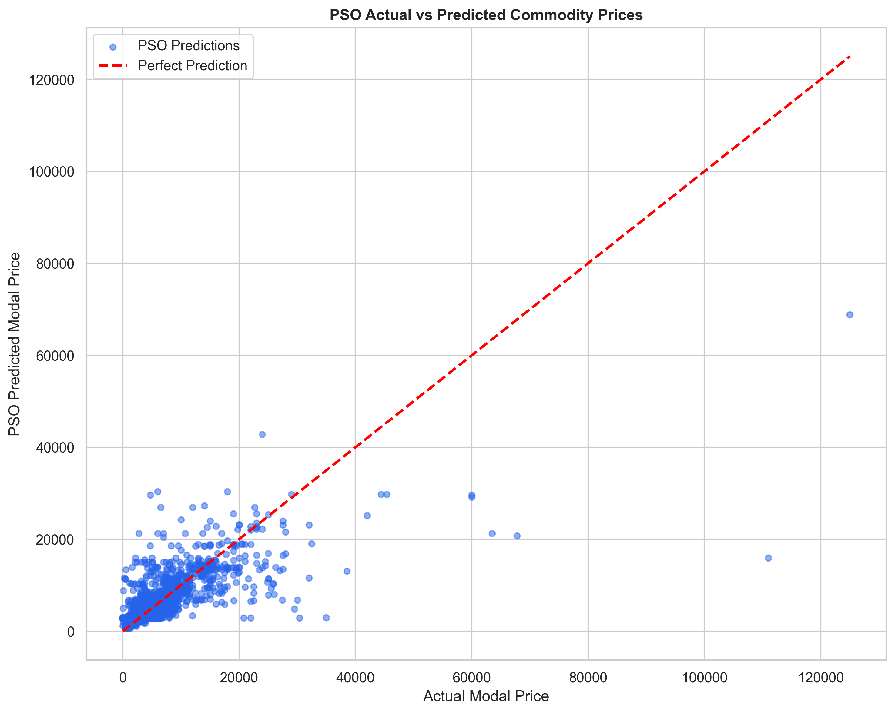

**Figure 15: PSO Actual vs Predicted Prices**

Shows the relationship between actual and PSO-estimated commodity prices.

---

## 16. PSO Prediction Graph


**Figure 16: PSO Commodity Price Prediction**

Compares actual prices, baseline predictions, and PSO predictions.

---

## 17. PSO Convergence Graph

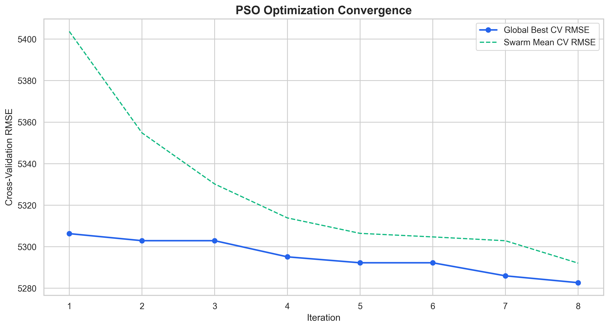

**Figure 17: PSO Optimization Convergence**

Shows the optimization progress across PSO iterations.

---

# Experimental Comparison

The project evaluates the following approaches:

| Approach | Prediction Model | Optimization |
|---|---|---|
| Baseline RF | Random Forest | None |
| Neural Network | Feedforward Neural Network | Adam training |
| AIS-RF | Random Forest | CLONALG |
| PSO-RF | Random Forest | PSO |

## Comparison Criteria

The experimental comparison considers:

1. Mean Absolute Error
2. Root Mean Squared Error
3. R² Score
4. Mean Absolute Percentage Error
5. Optimization Convergence
6. Model Complexity
7. Computational Cost

## Expected Evaluation

The purpose of the experiment is to determine whether AIS or PSO improves predictive performance compared with the baseline model.

Optimization does not guarantee improved results.

The final conclusion must be based on the actual generated evaluation metrics.

### Important Comparison Note

For rigorous comparisons, all models should use the same dataset, preprocessing assumptions, evaluation split, and compatible evaluation metrics.

AIS and PSO should also be compared under similar computational budgets.

---

# Optimal Market Recommendation System

The project includes a market recommendation module based on agricultural commodity price comparisons.

## Recommendation Methodology

The system:

1. Selects a commodity.
2. Identifies markets reporting the selected commodity.
3. Groups records by commodity, variety, and grade.
4. Calculates average reported modal prices.
5. Ranks markets by reported prices.
6. Returns the highest-ranked markets.

## Market Ranking

Markets are ranked according to their reported modal prices.

\[
MarketRank =
RankDescending(ModalPrice)
\]

Markets with higher reported modal prices receive better ranks within the same commodity, variety, and grade group.

## Recommendation Outputs

- `market_recommendations.csv`
- `Ais_market_recommendations.csv`
- `pso_market_recommendations.csv`

### Recommendation Limitation

These recommendations are based on reported prices.

They do not currently account for:

- Transportation costs
- Market fees
- Commodity quantity
- Storage expenses
- Market demand
- Distance from the farmer
- Net selling profit

Therefore, the recommendations represent price-based opportunities rather than guaranteed optimal-profit decisions.

The AIS and PSO versions use the same reported-price ranking methodology; the ranking itself is not optimized by AIS or PSO.

---

# Project Folder Structure

```text
AI-Based Agricultural Commodity Price Prediction
and Optimal Market Recommendation/
|
|-- 9ef84268-d588-465a-a308-a864a43d0070.csv
|
|-- README.md
|
|-- commodity_price_model.pkl
|-- commodity_price_model.h5
|-- nn_preprocessor.pkl
|-- config.yaml
|-- model_metrics.json
|-- evaluation_metrics.json
|-- dataset_summary.json
|-- project_summary.json
|
|-- accuracy_graph.png
|-- heatmap.png
|-- comparison_graph.png
|-- result.csv
|-- result_graph.png
|-- prediction.csv
|-- prediction_graph.png
|-- training_history.png
|-- model_comparison.csv
|-- market_recommendations.csv
|
|-- Ais_model.pkl
|-- Ais_model.h5
|-- Ais_config.yaml
|-- Ais_metrics.json
|-- Ais_accuracy_graph.png
|-- Ais_heatmap.png
|-- Ais_comparison_graph.png
|-- Ais_result.csv
|-- Ais_result_graph.png
|-- Ais_prediction.csv
|-- Ais_prediction_graph.png
|-- Ais_convergence_graph.png
|-- Ais_optimization_history.csv
|-- Ais_model_comparison.csv
|-- Ais_market_recommendations.csv
|-- Ais_project_summary.json
|
|-- pso_model.pkl
|-- pso_model.h5
|-- pso_config.yaml
|-- pso_metrics.json
|-- pso_accuracy_graph.png
|-- pso_heatmap.png
|-- pso_comparison_graph.png
|-- pso_result.csv
|-- pso_result_graph.png
|-- pso_prediction.csv
|-- pso_prediction_graph.png
|-- pso_convergence_graph.png
|-- pso_optimization_history.csv
|-- pso_model_comparison.csv
|-- pso_market_recommendations.csv
|-- pso_project_summary.json
```

The folder structure represents the expected outputs after all three implementations have executed successfully.

---

# Installation and Setup

## Step 1: Install Python

Install Python 3.10 or a compatible version supported by the selected TensorFlow release.

Verify the installation:

```bash
python --version
```

## Step 2: Install Dependencies

```bash
pip install numpy pandas scikit-learn matplotlib seaborn tensorflow joblib pyyaml h5py notebook
```

## Step 3: Open Jupyter Notebook

```bash
jupyter notebook
```

## Step 4: Configure Dataset Path

Use the following project directory:

```python
from pathlib import Path

BASE_DIR = Path(
    r"C:\Users\sagni\Downloads"
    r"\AI-Based Agricultural Commodity Price Prediction"
    r" and Optimal Market Recommendation"
)

DATASET_PATH = BASE_DIR / (
    "9ef84268-d588-465a-a308-a864a43d0070.csv"
)
```

## Step 5: Execute Baseline Model

Run the baseline machine learning notebook.

This generates:

- Trained models
- Accuracy graph
- Correlation heatmap
- Model comparison graph
- Prediction CSV
- Result CSV
- Market recommendation CSV

## Step 6: Execute AIS Model

Run the AIS optimization notebook.

This performs CLONALG-based Random Forest hyperparameter optimization and generates outputs beginning with `Ais_`.

## Step 7: Execute PSO Model

Run the PSO optimization notebook.

This performs particle swarm-based Random Forest hyperparameter optimization and generates outputs beginning with `pso_`.

## Step 8: Analyze Results

Compare the generated metrics:

```text
evaluation_metrics.json
Ais_metrics.json
pso_metrics.json
```

Review the corresponding graphs and prediction CSV files.

---

# Loading Trained Models

## Load Baseline Random Forest

```python
import joblib

model = joblib.load(
    "commodity_price_model.pkl"
)
```

## Load AIS-Optimized Model

```python
import joblib

ais_model = joblib.load(
    "Ais_model.pkl"
)
```

## Load PSO-Optimized Model

```python
import joblib

pso_model = joblib.load(
    "pso_model.pkl"
)
```

## Example Prediction

```python
import pandas as pd

sample = pd.DataFrame([{
    "State": "Odisha",
    "District": "Mayurbhanja",
    "Market": "Baripada APMC",
    "Commodity": "Brinjal",
    "Variety": "Brinjal",
    "Grade": "Medium"
}])

prediction = pso_model.predict(sample)

print(
    "Estimated Modal Price:",
    prediction[0]
)
```

The prediction is expressed in the same price units as the original dataset.

The input categories should preferably match categories represented in the training data.

---

# Research Applications

This project can support research in:

- Agricultural price intelligence
- Machine learning for agricultural markets
- Intelligent decision-support systems
- Bio-inspired optimization algorithms
- Agricultural market analytics
- Comparative optimization studies
- Data-driven agricultural planning
- Explainable agricultural price estimation

---

# Research Contributions

The project provides a framework for evaluating bio-inspired optimization techniques in agricultural commodity price estimation.

Its primary technical contributions are:

1. A machine learning pipeline for agricultural modal price estimation.
2. A Random Forest hyperparameter optimization approach using AIS.
3. A Random Forest hyperparameter optimization approach using PSO.
4. A comparative evaluation framework using regression metrics.
5. Optimization convergence visualization.
6. A reported-price-based market recommendation module.
7. Exportable models, predictions, and experiment configurations.

The originality and novelty of these contributions must be assessed against existing research before claiming a novel method.

---

# Advantages

- Uses real agricultural market records.
- Supports multiple commodity categories.
- Includes baseline and optimized prediction models.
- Provides automated evaluation.
- Supports visual comparison of model performance.
- Saves reusable trained models.
- Generates structured experiment outputs.
- Provides interpretable market price rankings.
- Supports reproducible experimentation.

---

# Limitations

The current implementation has several limitations.

### 1. Single-Date Dataset

The dataset contains observations from one reporting date.

This limits the project to cross-sectional price estimation rather than historical forecasting.

### 2. No Transportation Cost Data

The market recommendation module does not include transportation expenses or net-profit calculations.

### 3. Market Availability

The dataset does not establish whether a market is currently accepting a commodity or whether the quoted price is still available.

### 4. Optimization Cost

AIS and PSO require repeated model training and cross-validation, which increases computational requirements.

### 5. Generalization

A random record-level split evaluates performance on held-out observations, but may include the same markets and commodities in both training and testing.

Testing on unseen markets or later reporting dates would provide stronger evidence of generalization.

---

# Future Scope

The project can be extended in several directions.

## 1. Historical Price Forecasting

Collect multi-date agricultural market records and implement time-series forecasting.

Potential models include:

- LSTM
- GRU
- Temporal Convolutional Networks
- Transformer-based forecasting models

## 2. Hybrid AIS-PSO Optimization

Develop a hybrid algorithm combining AIS-based exploration and PSO-based search.

Evaluate whether the hybrid approach improves prediction performance and computational efficiency.

## 3. Profit-Based Market Recommendation

Include transportation cost, market fees, distance, quantity, and storage expenses.

A possible objective is:

\[
NetProfit =
SellingRevenue
-
TransportationCost
-
MarketFees
-
StorageCost
\]

## 4. Weather and Seasonal Features

Integrate weather, rainfall, seasonality, and agricultural production information.

## 5. Explainable AI

Use SHAP or permutation importance to explain the contribution of market and commodity features.

## 6. Web Application

Deploy the trained models through:

- Streamlit
- Flask
- FastAPI

## 7. Real-Time Agricultural Market Analytics

Integrate regularly updated agricultural market records to provide current price estimates and market comparisons.

---

# Conclusion

This project develops an AI-based agricultural commodity price estimation and market recommendation framework using Machine Learning, Artificial Immune System, and Particle Swarm Optimization.

The baseline implementation uses Random Forest and neural networks, while AIS and PSO optimize Random Forest hyperparameters.

The system evaluates prediction performance using MAE, RMSE, R², and MAPE, and generates visualizations, model files, prediction datasets, and optimization reports.

The market recommendation component identifies markets offering relatively higher reported commodity prices.

The experimental framework allows researchers to evaluate whether AIS or PSO improves model performance over conventional machine learning approaches.

Future extensions can incorporate historical price forecasting, hybrid optimization, transportation costs, and profit-based market selection.

---

# Keywords

Artificial Intelligence, Machine Learning, Agricultural Commodity Price Estimation, Agricultural Market Recommendation, Artificial Immune System, AIS, Clonal Selection Algorithm, CLONALG, Particle Swarm Optimization, PSO, Random Forest, Neural Network, Agricultural Analytics, Bio-Inspired Optimization, Regression Analysis, Decision Support System.

---

# License

This project is intended for educational, academic, and research purposes.

Dataset usage and redistribution should comply with the original dataset provider's terms.

A software license should be selected before public redistribution.

---

# Acknowledgment

This project uses Python and open-source machine learning libraries, including Scikit-learn, TensorFlow, Pandas, NumPy, Matplotlib, and Seaborn.

The project demonstrates the application of machine learning and bio-inspired optimization to agricultural market price analysis.
